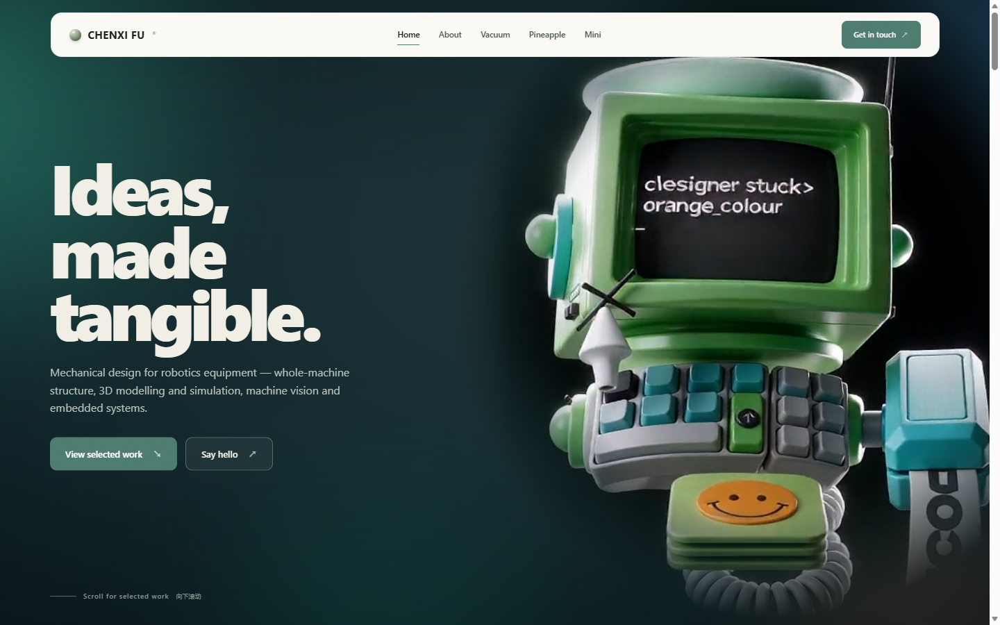
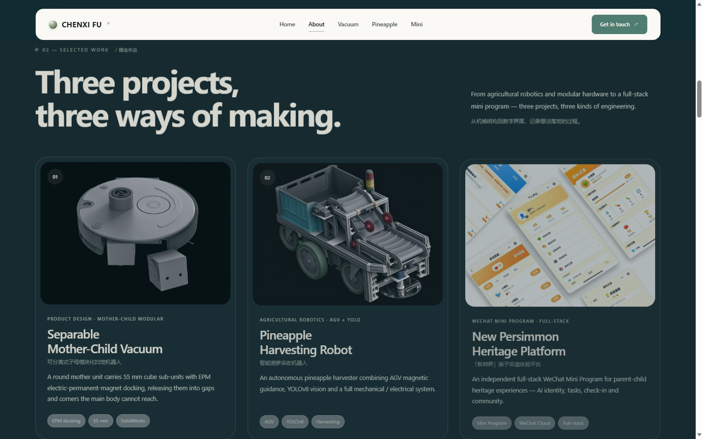
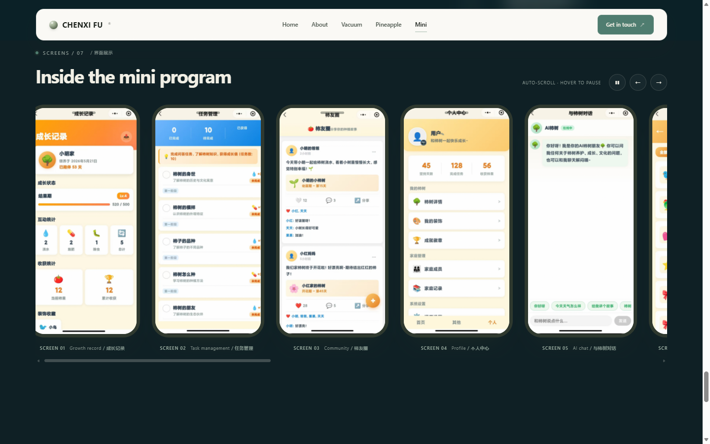

# Chenxi Fu — Mechanical Design / Robotics Portfolio

A static personal portfolio for mechanical design and robotics equipment R&D:
whole-machine structural design, 3D modelling and simulation, machine vision,
embedded systems, and one full-stack WeChat Mini Program.

> **Live site:** https://YOUR-USERNAME.github.io/YOUR-REPO/  
> Replace `YOUR-USERNAME` and `YOUR-REPO` after enabling GitHub Pages.





## About

I am Chenxi Fu (付晨希), a mechanical design student at Liaoning Technical University,
working toward robotics equipment R&D. This site collects my profile, technical
drawings, project documentation and product screens.

## Sections

- **Home** — dark editorial hero with a looping robot render.
- **Profile** — education, contact, CET results, honours, competitions and skills.
- **Work 01 — Separable Mother-Child Vacuum** — round mother unit + 55 mm cube
  sub-units, EPM magnetic docking, technical plates, cutaway and BOM.
- **Work 02 — Pineapple Harvesting Robot** — AGV magnetic guidance, YOLOv8 vision,
  mechanical / conveying / cutting systems and a layered electrical architecture.
- **Work 03 — New Persimmon** — parent-child heritage WeChat Mini Program with
  AI identity, task growth, offline check-in and UGC community.



## Tech

- HTML, CSS and vanilla JavaScript
- No framework, no build step, no backend
- All images and the robot video are stored locally in `assets/`

## Run locally

Open `index.html` directly, or serve the folder:

```bash
python -m http.server 8000
```

Then open `http://localhost:8000/`.

## Deploy to GitHub Pages

1. Create a public repository.
2. Upload the **contents of the upload folder** to the repository root:
   `index.html`, `assets/`, `README.md`, `.nojekyll`.
3. Open **Settings → Pages**.
4. Under **Build and deployment**, choose **Deploy from a branch**.
5. Select branch **main** and folder **/(root)**, then **Save**.
6. Wait 1–3 minutes and open:
   `https://YOUR-USERNAME.github.io/YOUR-REPO/`

No Actions, npm or server are required.

## Structure

```text
index.html
assets/
  css/style.css
  js/main.js
  crt-robot.mp4
  crt-robot-poster.jpg
  works/
    work-01-vacuum.jpg
    work-02-pineapple.jpg
    work-03-mini.jpg
    vacuum-01-full.png ... vacuum-04-cutaway-pair.png
    pineapple-01-model.png
    pineapple-02-lineart.png
    mini-01-growth.png ... mini-07-achievements.png
```

## Contact

- Email: 2169490740@qq.com
- Phone: 133 1897 4644
- Location: Zhuhai, China

© 2026 Chenxi Fu. All rights reserved.
